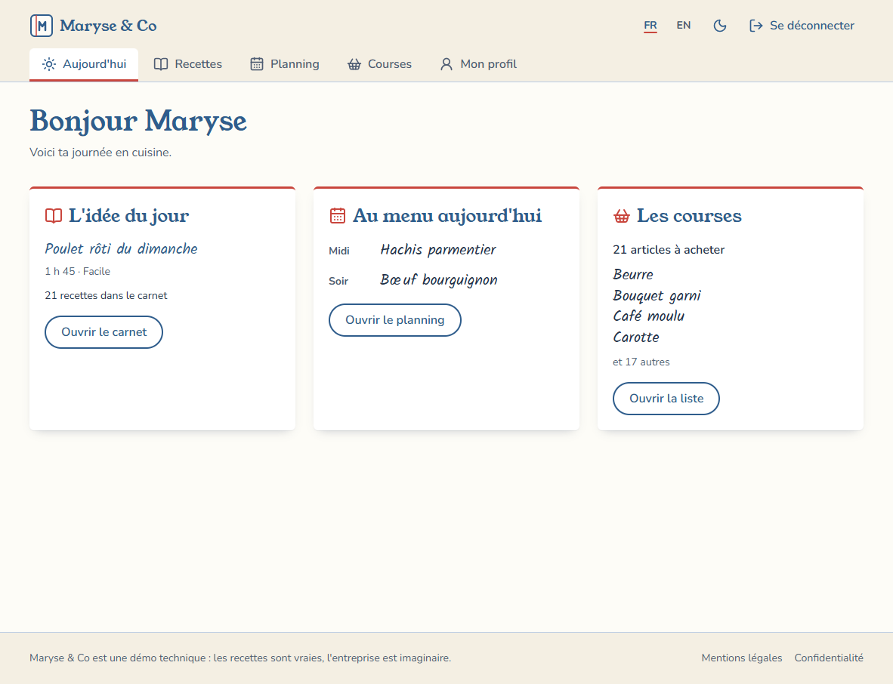
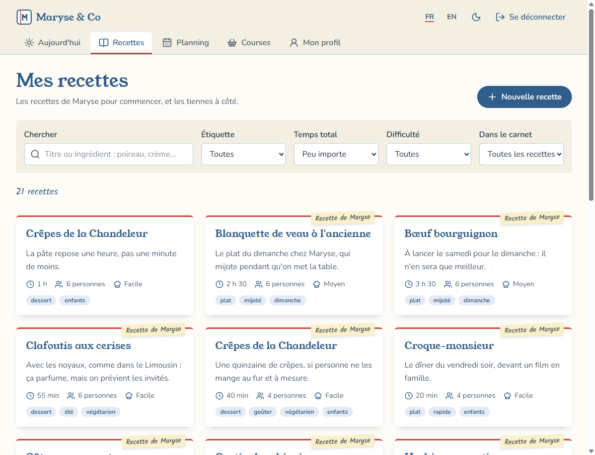
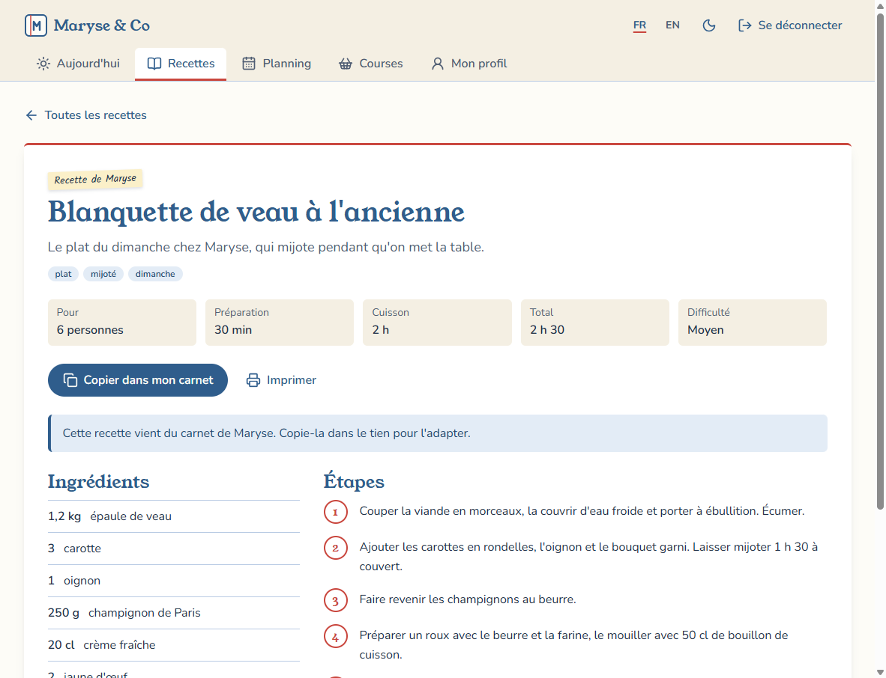
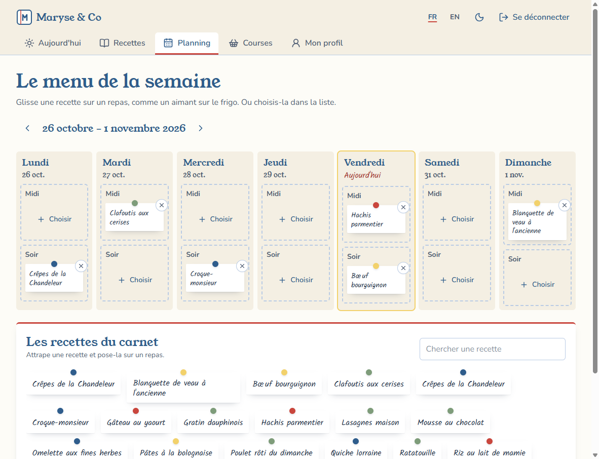
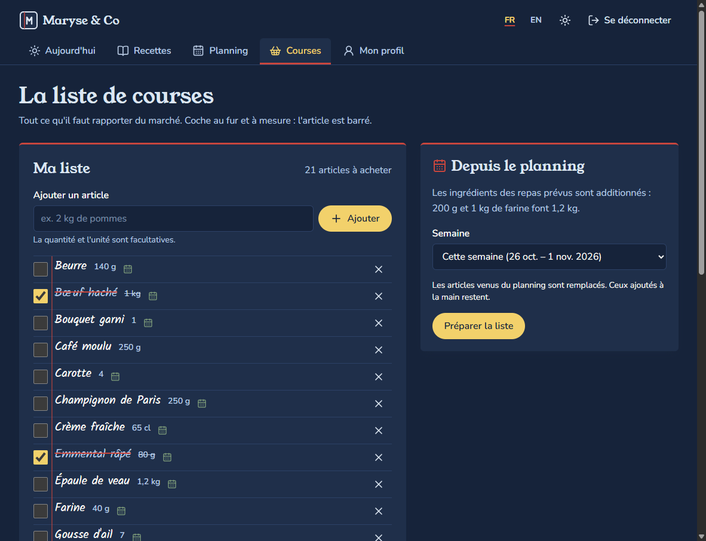

# Maryse & Co

Le carnet de cuisine familial de Maryse, en application web : des recettes, le planning des repas de la
semaine et la liste de courses qui se fait toute seule.

- **Démo** : `https://<propriétaire>.github.io/POCMARYSE/` (l'adresse exacte s'affiche avec `npm run diagnostic`)
- **Statut** : POC / démo technique, v1.0.0 (voir [`docs/ROADMAP.md`](docs/ROADMAP.md))



## Ce que fait l'application

- **Site vitrine** : l'histoire de Maryse, les fonctionnalités, la création de compte.
- **Recettes** : un carnet personnel, les recettes de Maryse à copier, recherche sans accents et filtres
  conservés dans l'URL, fiches imprimables.
- **Planning** : la semaine en grille midi / soir, on y glisse ses recettes comme des aimants sur le frigo
  (souris, toucher ou clavier).
- **Courses** : la liste est préparée à partir du planning, ingrédients regroupés et additionnés
  (200 g + 1 kg = 1,2 kg), articles ajoutés à la main, barrés une fois cochés.
- **Tableau de bord et profil** : l'essentiel du jour ; prénom, langue et thème gardés sur le compte.
- Interface en **français** et en **anglais**, thème **clair**, **sombre** ou celui de l'appareil.

| Recettes | Fiche recette |
|---|---|
|  |  |
| **Planning** | **Courses (thème sombre)** |
|  |  |

## Stack

Vite, React, TypeScript strict, Tailwind CSS, React Query, Supabase (auth + PostgreSQL + RLS),
hébergé sur GitHub Pages. Les choix sont expliqués dans [`docs/adr/`](docs/adr/).

L'application est **modulaire** : chaque domaine (recettes, planning, courses) est un dossier
`src/modules/<id>/` déclaré dans un registre, qui fournit ses routes, son entrée de menu, ses traductions
et son widget de tableau de bord (ADR 0005). Les idées de modules suivants sont dans
[`docs/MODULES_A_VENIR.md`](docs/MODULES_A_VENIR.md).

## Démarrer en local

Prérequis : Node.js 22 (voir `.nvmrc`).

```bash
npm install
cp .env.example .env.local   # puis renseigner les variables Supabase
npm run dev                  # http://localhost:5173/POCMARYSE/
```

Sans variables Supabase, la vitrine fonctionne mais l'application affiche « Backend non configuré ».
La mise en place du backend est décrite dans [`docs/SUPABASE_SETUP.md`](docs/SUPABASE_SETUP.md).

## Commandes

| Commande | Rôle |
|---|---|
| `npm run dev` | serveur de développement |
| `npm run build` | build de production (avec `404.html` pour GitHub Pages) |
| `npm run preview` | prévisualise le build |
| `npm run lint` | ESLint (dont les règles de dépendance entre couches) et vérification UTF-8 |
| `npm run typecheck` | vérification TypeScript |
| `npm run test` | tests Vitest |
| `npm run format` | formatage Prettier |
| `npm run typo:fr` | espaces insécables de la typographie française dans les traductions |
| `npm run publier` | met en ligne la demande en cours (PR, CI, fusion, déploiement, contrôle) |
| `npm run annuler` | remet en ligne la version précédente |
| `npm run diagnostic` | état de la CI, du déploiement, du site et de Supabase |

## Documentation

- [`AGENTS.md`](AGENTS.md) : règles du projet (à lire en premier, humain ou IA).
- [`CONTRIBUTING.md`](CONTRIBUTING.md) : conventions et ajout d'un module.
- [`docs/adr/`](docs/adr/) : registre des décisions d'architecture.
- [`docs/ROADMAP.md`](docs/ROADMAP.md) : jalons et avancement.
- [`docs/MODULES_A_VENIR.md`](docs/MODULES_A_VENIR.md) : idées de modules.
- [`docs/SUPABASE_SETUP.md`](docs/SUPABASE_SETUP.md) : créer et relier le backend.
- [`docs/MAINTENANCE.md`](docs/MAINTENANCE.md) : mise en ligne, pannes, retour arrière, mises à jour.
- [`docs/GUIDE_ASSOCIATION.md`](docs/GUIDE_ASSOCIATION.md) : guide pour la personne qui entretient le site avec Cursor.
- [`CHANGELOG.md`](CHANGELOG.md) : historique des versions.

## Déploiement

Chaque demande se fait sur une branche `demande/<sujet>`. `npm run publier` vérifie le travail, ouvre la PR vers
`main`, attend la CI, fusionne, puis `deploy.yml` publie le site, le contrôle et pose le tag de version. En cas
de problème, le dernier tag sain est remis en ligne automatiquement, et `npm run annuler` revient en arrière à la
demande. Détails : [`docs/MAINTENANCE.md`](docs/MAINTENANCE.md) et ADR 0014. Pour la personne qui entretient le
site avec Cursor : [`docs/GUIDE_ASSOCIATION.md`](docs/GUIDE_ASSOCIATION.md).
